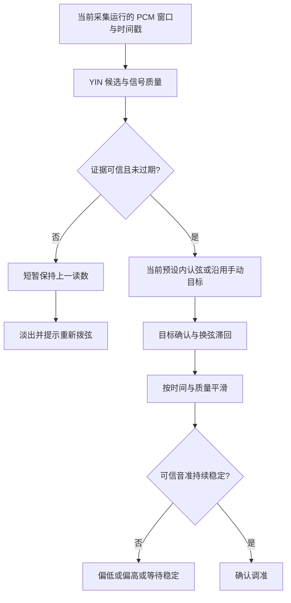

# 调音算法优化：事实基线与决策访谈

日期：2026-10-31。状态：已按用户后续调用 to-spec 转为[可交付规格](2026-10-31-tuner-stability-issue-spec.md)。Q1–Q8 已确认；Q9–Q10 保留未决并排除在本票新增行为之外，不再继续访谈。工程数值仍为建议起点，未据此修改运行算法。

已发布：[GitHub #60 — 调音算法稳定性优化与四套调弦预设](https://github.com/haizei/foxgita/issues/60)，标签为 `ready-for-agent`。本地规格正文与发布内容一致。

## 1. 已确认的产品目标

- 优先稳定易用：减少错误读数、误切弦和误报调准，同时保留可感知的拧弦跟随。
- 本轮保留六弦标准调弦、Drop D、现有 DADGAD，并新增整体降半音；四套预设共用检测与稳定策略。
- 面向手机麦克风、单根空弦、安静房间及普通生活噪声，不将多人合奏分离或伴奏消除列为本轮成功条件。
- 保留现有实时调音的设备端分析、不保存声音、不累计练习时长、不创建练习记录边界。
- 界面继续采用已选琴头布局。读数须区分目标频率与实测频率，不能把目标值冒充测量结果。

### 1.1 已确认的交互判定

- Q4：用户先明确选择预设，算法仅在当前预设内自动识弦，不根据声音自动切换调弦方案。
- Q5：弱尾音短暂保留最后可靠读数，随后淡出并提示重新拨弦；保持阶段不发布新的拧紧/放松建议。
- Q6：准确区间内持续稳定才确认调准；瞬时入区、冻结读数或过期结果都不能确认调准。
- Q7：标准音期间暂停调音判定，播放停止并处理余音后恢复。退出、后台或中断仍撤销待恢复任务。
- Q8：保留现有 DADGAD，不因新增整体降半音删除旧功能。

## 2. 当前实现，而非待实现设想

本次核查为只读代码调查，没有重新运行测试。下面的历史测试结果均来自已有验收文档，不代表本轮新验证。

| 环节 | 当前事实 | 本轮应避免的误判 |
| --- | --- | --- |
| 音高估计 | `TunerPitchDetector.swift` 使用 YIN 差分、累计均值归一化差分与抛物线插值，平方差调用 Accelerate | 并不是只有 FFT 最大峰，也不是尚未实现音高检测 |
| 窗口 | 1024 个降采样点；48 kHz 输入约 85.3 ms，44.1 kHz 约 92.9 ms | 旧版 2048 点已修复，不重复加速旧版本 |
| 弱音与谐波 | 去直流、RMS 下限 0.0002；已有二/三倍周期比较 | 不能简单宣称缺少全部弱音或泛音处理 |
| 流式处理 | 有界 PCM 环形缓冲，单个后台分析任务，忙时保留最新 PCM，hop 为窗口的四分之一 | 不再是分析忙时丢掉全部新输入 |
| 模型可信门槛 | 周期分数至少 0.95，基频范围 55–600 Hz | 周期分数不是经过校准的正确概率 |
| 自动识弦 | 当前预设中选择绝对音分距离最近的弦；距离超过 180 cent 则不认弦；可信帧可立即切弦 | 尚无切弦驻留与滞回 |
| 平滑 | 音分域质量自适应，权重 0.08–0.75；四个可信频率判断同向运动 | 已不是旧三帧中值，但系数依赖帧到达频率 |
| 读数失效 | 不可信非空结果立即撤下公开读数；nil 保留至超时；超过 0.6 秒无可信更新清滤波 | 两种信号不足路径的展示规则不同 |
| 调准 | 平滑结果进入 ±6 cent 即分类为 inTune | 没有持续稳定确认、进入/退出双阈值 |
| 调弦范围 | 已有 standard、dropD、dadgad | 整体降半音尚未实现；A4 校准不是替代调弦 |
| 标准音与生命周期 | 标准音期间暂停收音，结束后按页面状态恢复；退出、后台、中断取消恢复 | 该安全边界已存在，应保留并检查余音边界 |
| 音频会话 | 调音持有 `.tuning` 所有权时使用 `.measurement`；与播放/录音需求通过引用计数协调 | 引用计数不等于多个输入引擎之间的排他仲裁 |

代码定位：

- [估计器](../../foxgita/Features/Tools/Tuner/TunerPitchDetector.swift)：窗口与降采样 13–37 行，质量门控 38–64 行，周期候选修正 77–91 行。
- [音频服务](../../foxgita/Features/Tools/Tuner/TunerAudioService.swift)：流式 worker 与输入 tap。
- [调音模型](../../foxgita/Features/Tools/Tuner/TunerModel.swift)：可信结果与选弦 142–168 行，平滑 169–195 行，标准音恢复 201 行起。
- [调弦定义](../../foxgita/Features/Tools/Tuner/GuitarTuning.swift)：预设 15 行起，调准分类 39 行起。
- [音频会话协调](../../foxgita/Services/AudioSessionCoordinator.swift)：调音模式 31 行起，会话配置 120 行起。

已有证据：[低 E 响应修复](2026-10-31-tuner-response-fix.md)、[尾音稳定修复](2026-10-31-tuner-decay-stability.md)。历史文档报告 684 项回归通过，实体设备验收按开关跳过；Mac 上约 0.83 ms 的检测函数 p95 不等于 iPhone 端到端延迟。真实吉他录音的检出窗口计数也不等于估计准确率。

## 3. 优化顺序建议

### P0：先阻止错误决策，而不是先更换估计器

1. 将“信号可信”“当前是哪根弦”“读数跟随”“已确认调准”拆成独立判断。一次可信估计不自动等于换弦成立，也不自动等于调准成立。
2. 增加自动选弦的候选、锁定与切换规则，防止相邻弦、泛音与尾音噪声让目标来回跳。目标距离只影响候选选择，不能反向把估计频率拉到目标音。
3. 将进入准确区间与确认调准分开。候选时间必须基于真实有效观测；陈旧读数和弱尾音保持不得继续累计调准时间。
4. 统一无信号与不可信输入的状态规则，区分“短暂保持最后可信读数”和“仍在实时追踪”。保持期间不产生新的拧弦建议或调准事件。
5. 新增整体降半音预设；所有频率由音符与 A4 校准统一推导，不从 UI 四舍五入后的频率反算。

### P1：改善稳定性与跟随之间的取舍

1. 平滑改为按真实时间间隔计算。建议使用 `alpha = 1 - exp(-dt / tau)` 的时间常数形式，以减少 tap 节奏和处理负载对手感的影响；质量与持续运动控制 tau，具体范围由回放数据标定。
2. 为估计传递采样位置、窗口末端时间和观测年龄。调准驻留、切弦确认与过期判断使用输入证据时间，不能只用模型收到回调的时间。
3. 谐波/八度错误作为独立失败类型评估。已有二/三倍周期保护应先回归；新增候选必须结合周期证据、谐波证据与连续性，不能仅因为某个候选更接近目标音就选择它。
4. 建立普通生活噪声的自适应质量判断候选：估计无琴弦时的噪声底，在可信持续弦音与系统标准音期间避免错误更新；结合周期性、相对能量、削波和瞬态标志决定是否发布结果。不能仅靠再抬高绝对 RMS 门槛解决噪声。
5. 起音处理不采用对所有音固定屏蔽一段时间的方式。拨弦攻击阶段可先发布可信方向，只有证据持续可靠后才允许调准确认；对瞬态抑制的延迟代价单独测量。

### P2：先证明收益，再改变 DSP 成本

- 评估当前分组平均降采样的抗混叠能力。只有噪声/高频样本证明有收益，再引入低通与降采样优化，并计入群延迟、CPU 和低音精度代价。
- 以当前 YIN 为基线，必要时离线对比 MPM 或不同候选提取方案；未获得相同样本上的收益前，不增加双算法实时运行或机器学习依赖。
- 不承诺只凭单个周期性指标可靠区分人声、电视和琴弦；单音人声也可能高度周期。证据不足应拒绝给出精确调音建议。

以上是工程建议，不是已实施效果或已确认参数。

## 4. 核心计算与边界

所有列表统一使用“第六弦 → 第一弦”的顺序，避免琴头图左右排列与内部弦序混淆。

| 预设 | 目标音名，第六弦 → 第一弦 | 对应音符编号 m |
| --- | --- | --- |
| 标准 | E₂ / A₂ / D₃ / G₃ / B₃ / E₄ | 40 / 45 / 50 / 55 / 59 / 64 |
| Drop D | D₂ / A₂ / D₃ / G₃ / B₃ / E₄ | 38 / 45 / 50 / 55 / 59 / 64 |
| 整体降半音 | E♭₂ / A♭₂ / D♭₃ / G♭₃ / B♭₃ / E♭₄ | 39 / 44 / 49 / 54 / 58 / 63 |
| DADGAD | D₂ / A₂ / D₃ / G₃ / A₃ / D₄ | 38 / 45 / 50 / 55 / 57 / 62 |

- 以音符编号 m 和用户校准 A4 推导目标：`f_target = A4 × 2^((m - 69) / 12)`。
- 实际偏差：`cents = 1200 × log2(f_measured / f_target)`；负值偏低，正值偏高。
- ±50 cent 是刻度显示边界，不是实际偏差截断边界。超出显示范围仍须保留真实数值与方向。
- 手动选弦保持用户指定目标和真实八度差；不能把 ±1200 cent 包装成接近 0 的“调准”。
- 自动模式仅承诺空弦识别。严重偏调、泛音与多弦同时发声可能产生目标歧义，需要明确拒绝或引导手动选弦的规则。
- 概念上区分“估计误差”“琴弦相对目标的偏差”“展示抖动”。真实录音本身偏离标准音时，不能将它与目标的距离当作检测误差。
- 重叠窗口并非相互独立的观测，不把“连续 N 帧”当作统计置信概率；涉及持续时间的策略须使用时间戳。

## 5. 验收方法草案

具体门槛待产品行为确认后冻结，以下先定义评估方法，避免用没有可比性的数字宣称优化。

| 维度 | 必测场景 | 判断口径 |
| --- | --- | --- |
| 基频精度 | 四套预设全部六空弦、44.1/48 kHz、不同音量与 A4 校准 | 对独立参考基频计绝对音分误差 p50/p95；拒绝窗口另计，不从准确率分母静默删除 |
| 尾音 | 固定基频、真实衰减、不同二三次谐波比例、生活噪声 | 同时报可信覆盖率、读数摆幅和误差，不能靠全部拒绝尾音获得稳定 |
| 跟随 | 连续拧弦扫音、快速拨另一根弦、相邻音区来回变化 | 跟随滞后、首次可信读数时间、换弦时间；分析窗口内真值与最新瞬时真值分开处理 |
| 误判 | 强二次泛音、弱基音、相邻弦共振、六弦与一弦同名 E | 八度错误率、错误琴弦锁定次数、错误锁定持续时间 |
| 噪声 | 风扇、空调、谈话、电视、触碰机身、轻微削波、两根弦同时响 | 无有效单弦证据时的误发布次数/分钟、错误调准次数，以及能否恢复正常识音 |
| 状态 | 静音、短暂干扰、尾音失效、预设与校准切换、手动/自动切换 | 不跨目标继承驻留，不在冻结读数上判调准，不显示过期方向 |
| 音频边界 | 标准音停止与余音、后台/返回、来电、中断、路由及采样率变化 | 不把自身标准音认成琴弦，不意外恢复旧采集，不接收旧会话结果 |
| 真机性能 | 内置麦克风和目标 iPhone；区分冷启动、已启动后的拨弦响应 | PCM 时间戳到显示的端到端分布、CPU、内存及掉帧；不以 Mac 检测耗时代替 |

合成 PCM 用于有精确真值的算法回归；公开真实吉他样本用于音色覆盖；用户授权的真机体验或本地测试样本用于端到端评估。默认不保存用户环境音。测量若需要保留录音，应作为单独明确授权的诊断过程。

## 6. 访谈设计树与未决项

已确定：稳定易用 → 普通房间单弦使用 → 用户选择预设 → 预设内自动识弦 → 弱尾音保持后淡出 → 持续稳定确认调准 → 标准音结束后恢复；四套预设含原有 DADGAD。

尚未得到回答的产品提案，本票不实施：

- Q9：严重偏调或识弦歧义时，引导手动选弦，还是始终猜测最近目标？建议引导手动选择。
- Q10：练习录音/节拍器运行时，明确暂停或结束相关音频再进入调音，还是同时运行？建议明确切换，并由用户手动恢复。

工程参数见第 8 节，为建议起点；实现者须用回放与真机证据校准，不能将它们描述成用户逐项批准的参数。Q8 已确认保留 DADGAD。

用户已切换为 to-spec 流程；本次交付为整理并发布规格，未修改运行算法。规格沿用现有严重跑音与音频协作行为，将 Q9、Q10 的新提案留作后续范围。已确认术语已更新至 [CONTEXT.md](../../CONTEXT.md)。未决的跨功能音频取舍不记录为 accepted ADR；常数调参和普通实现步骤留在设计文档。

## 7. 外部依据

- [YIN 原始论文记录](https://pubmed.ncbi.nlm.nih.gov/12002874/)：周期估计方法的来源，不据论文中的语音评估结果推断本产品吉他准确率。
- [McLeod / Wyvill：A Smarter Way to Find Pitch](https://www.researchgate.net/profile/Geoff-Wyvill/publication/230554927_A_smarter_way_to_find_pitch/links/561a12f108aea80367211169/A-smarter-way-to-find-pitch.pdf?origin=publication_detail)：MPM 的原始论文，仅作为后续基线对照候选。
- [Apple measurement 模式](https://developer.apple.com/documentation/avfaudio/avaudiosession/mode-swift.struct/measurement)：减少部分系统输入/输出处理，不等于环境降噪能力保证。
- [Apple preferredSampleRate](https://developer.apple.com/documentation/avfaudio/avaudiosession/preferredsamplerate)：请求值不代表实际采样率，应读取实际格式。
- [Apple preferred I/O buffer duration](https://developer.apple.com/documentation/avfaudio/avaudiosession/setpreferrediobufferduration(_:))：缓冲时长是请求，须核对实际时长，不能由 tap 请求帧长推断完整链路延迟。

## 8. 状态机与初始调参建议

本节是依据已确认产品行为制定的工程建议。数值不是当前实现，也不是已有真机测量结论；实现时应作为集中配置，并通过回放数据校准。

### 8.1 将状态分为音频、识弦与反馈三层

图中的“保持”不向“确认调准”提供证据；恢复可信输入后重新经过质量、目标与稳定性判断。

音频层区分：未启动、收音中、播放标准音、等待余音消退、暂停、权限/设备错误。只有收音中才允许新的调音判定。每次重启采集生成新的运行标识，旧运行的分析回调不得更新当前状态。

识弦层区分：无候选、候选待确认、目标已锁定、候选切换待确认。手动模式固定用户指定的目标，不执行自动换弦。切换预设、校准频率或手动目标后，清除旧目标的识弦候选与调准累计。

反馈层区分：等待拨弦、可信追踪、准确区间待稳定、已确认调准、读数保持、需要重新拨弦。收音中断、弱音保持、目标改变以及超龄结果均不能沿用旧的调准驻留。

### 8.2 推荐起始参数

| 策略 | 建议起点 | 标定时观察什么 |
| --- | --- | --- |
| 首次自动认弦 | 同一可信候选持续约 80 ms，再发布锁定目标 | 首次读数延迟、初始错误弦锁定率 |
| 自动换弦 | 新候选持续约 120 ms，且较旧目标至少近 50 cent | DADGAD 相邻音区、共振与尾音误切；连续拨另一弦能否及时切换 |
| 自动候选范围 | 先保留现有目标距离不超过 180 cent 的边界；候选证据不足不强行识弦 | 严重偏调的覆盖率与误锁目标；最终产品行为取决于 Q9 |
| 调准进入 | 真实可信观测与平滑读数均落入 ±5 cent，持续约 400 ms；期间音分摆幅不超过约 4 cent | 漂移穿过中心能否被拒绝、稳定弦能否顺利确认 |
| 调准退出 | 新鲜可信偏差超过 ±8 cent 时退出；信号失效进入保持态并撤去“已调准”确认 | 避免准确区边缘闪烁，同时及时撤掉失效确认 |
| 弱音保持 | 最后可靠读数最多保留约 300 ms，以弱化样式表达“上一读数”；随后淡出并提示重新拨弦 | 尾音闪烁、恢复手感，以及是否被误当成实时结果 |
| 连续证据断开 | 相邻有效观测时间间隔超过约 100 ms，重新累计认弦/调准证据 | 重负载、干扰间隙、迟到结果不能凭空获得驻留时间 |
| 发布结果年龄 | 以窗口末端时间判断；建议先以 150 ms 为过期上限候选 | 真机输入缓冲与后台调度；过期率须与端到端延迟一起报告 |
| 标准音余音 | 播放结束后至少留出约 200 ms 的隔离起点，再验证实际余音，不让标准音参与认弦或调准 | 不同扬声器音量、房间混响；不能把固定 200 ms 当作余音必然消失的保证 |

“持续”基于采样时间线，不以收到 N 个回调替代。旧窗口、重复估计和冻结读数不能使计时前进；缺失时间不能算作可信覆盖。候选切换期间停止将新频率与旧目标组合输出建议。

### 8.3 平滑与真实运动

频率先换算为不依赖当前琴弦目标的连续音分坐标，再进行质量自适应平滑；最后与锁定目标比较。稳态可从 120–180 ms 的时间常数范围起测，持续真实拧弦可从 30–60 ms 起测。对突发尖峰不只凭变化幅度提高响应。

候选尚未通过换弦确认时，禁止将新琴弦读数平滑穿过旧琴弦的准确区。实际换弦成立后重置滤波；手动模式则保留真实大偏差，不将它折叠到同名八度。

噪声底、周期分数和运动一致性共同决定是否更新，不把 YIN 的 0.95 指标当成 95% 的正确概率。现有门槛先保留作为对照，再用同样样本证明新质量策略同时改善误报与有效覆盖。

### 8.4 性能与准确度验收建议

- 延续已存在的确定性 PCM 标准：可信尾音绝对误差小于 2.5 cent、摆幅小于 4 cent，并保留足量有效读数；连续 40 cent/s 扫音跟随误差小于 5 cent，四套预设均覆盖。
- 新增对短暂入区、平滑穿越中心、弱音冻结、目标改变和回调中断的反例测试，不得错误确认调准。稳定音样本必须能够在合理时间内确认，避免靠永不确认通过。
- 真机目标建议：已启动收音后，从拨弦起点到首次可信锁定读数 p95 不超过 300 ms，换弦确认 p95 不超过 350 ms；冷启动权限/会话建立另计。必须用目标手机测量后才能声称通过。
- 普通生活噪声报告错误认弦次数/分钟、错误调准次数、有效琴弦检出率和恢复时间；先建立相同输入的当前版本基线，再确定可发布门槛，不将“普通房间”当作单一固定噪声等级。
- 上述时间是建议的工程目标；若真机证据显示稳定性与响应不可同时满足，应回到已确认的稳定易用优先原则，记录取舍，不隐藏拒绝率或只报告成功样本。
