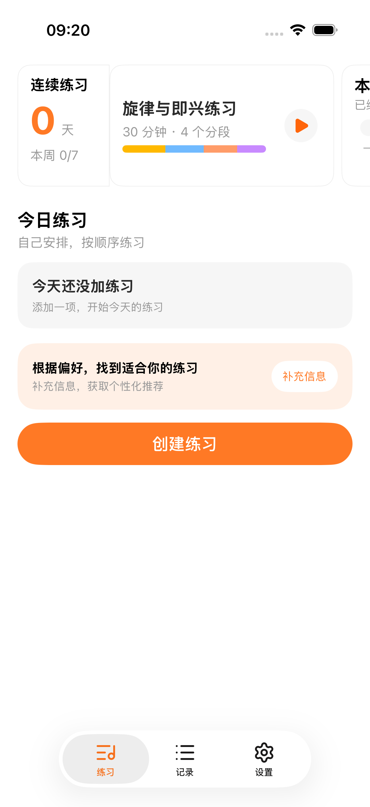
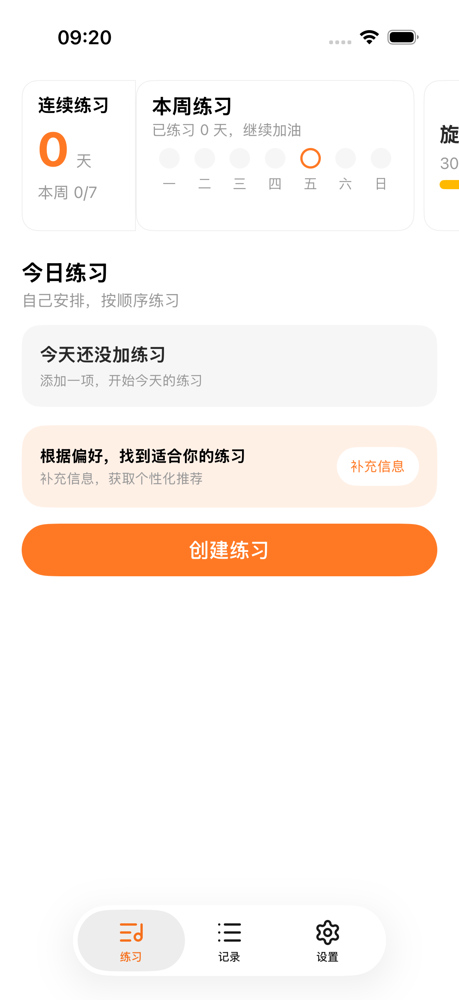

# 今日练习首页 Figma 同步

日期：2026-10-30

## 设计依据

- [主流程 / 今日练习 → 记录 → 复盘](https://www.figma.com/design/smeuuUaTOYE1URHhIGbzyd/?node-id=99-57)
- 首页：58:3；左滑本周练习：2691:2344；完善偏好后：首页 2432:169。
- 采用已确认的方案 1：连续练习摘要固定在左侧，方案内容与播放按钮分列，播放按钮垂直居中。

## 实现

- 首页改为白色表面、132pt 紧凑卡片、横向分页及下一张露出，左滑显示本周练习。
- 连续练习、本周天数和星期状态读取有效练习事实；设计中的 7 天、4/7 和示例任务不作为默认数据。
- 移除问候语和顶部方案标签层；今日练习说明保留“自己安排，按顺序练习”。
- 列表改为轻描边和中性开始按钮；保留滑动编辑/删除及项目关联。
- 保留原有偏好卡，统一为一个“创建练习”入口，随内容滚动。
- 播放、星期状态、Tab 图标及推荐插图使用 Figma 原始导出资源；字体继续使用支持动态字号的 GitaFont。
- 保留方案训练、笔记、记录与项目的现有业务行为。记录页已有的“练习 / 项目”架构继续使用。

## 验证

设备：iPhone 17 模拟器，iOS 26.5。Xcode Debug build-for-testing 通过。

- StatsAggregatorTests 与 PracticeHomeStateTests：39 项通过。
- 首轮通过：创建练习进入详情、首页内容、笔记语音/图片入口、记录页入口、四分段方案训练与时长聚合。
- 定向复验通过：首页分页往返、播放按钮 44pt 点击区域与垂直居中、偏好草稿恢复和显式保存方案、倒计时仅保存计划且笔记返回重进可恢复。
- 已修正旧方案文案断言、嵌套滚动容器选择、首页分页的无障碍标识覆盖。
- 长内容测试中，创建按钮局部露出时 `isHittable` 仍为 true，而中心点位于原生 TabBar 内；测试现在先滚动到控件完整可见再点击。最终定向复验通过，推荐重复添加不会生成重复练习，创建面板正常打开和关闭。
- 共通过 39 项单测、9 条不同的关键 UI 场景；失败项修正后均已定向复验通过。首轮问卷场景遇到一次 SIGTERM，重跑通过。
- 代码审查通过，无可确认的可操作问题。

构建及结果日志：`/tmp/gita-home-frontend-build-v3.log`；回归结果分别位于 `/tmp/gita-home-frontend-ui.xcresult`、`/tmp/gita-home-frontend-v2.xcresult`、`/tmp/gita-home-frontend-v3.xcresult`。

## 模拟器截图

以下为隔离测试数据的空列表状态，未写入设计稿示例练习。

| 默认方案 | 左滑后的本周练习 |
| --- | --- |
|  |  |

本次验证范围为模拟器前端及业务回归，不包含真机音频长测。
