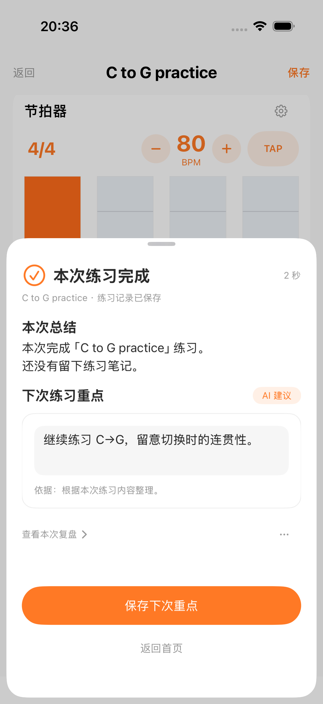
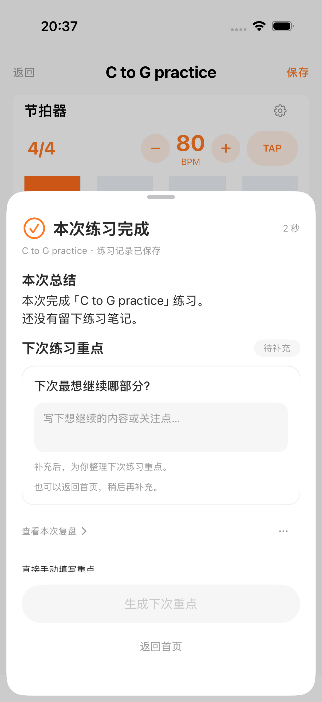

# 练后 AI 建议 · 下次重点验收

设计：[Figma 2879:7696](https://www.figma.com/design/smeuuUaTOYE1URHhIGbzyd?node-id=2879-7696)。实现为原生 SwiftUI 完成弹层，沿用 Gita 颜色、字体与控件。

已完成生成结果、信息不足补充、手动降级、未确认草稿保留、来源回看、过时结果保护、项目失败单独重试。首页每份档案最多一条已确认重点，不匹配练习；开始后通过当天练习记录接续，不自动计时。

## 最终两态截图

截图来自 `/private/tmp/gita-next-focus-latest-ui.xcresult`，三项界面测试全部通过。复盘入口在重点卡之后，生成与自动整理设置放入轻量菜单，操作区固定在底部。

| 已生成、待确认 | 信息不足、待补充 |
| --- | --- |
|  |  |

## 验证记录

- 本功能相关 45 项不同用例通过，含 36 项现有核心、5 项新增输入与取消回归、4 项界面验证。最后一版菜单布局又完成 3 项界面复跑。
- Swift 与规格两轴复审通过，无未解决的功能问题。
- [真实 AI 联调](2026-11-06-suggested-practice-live.md)已通过真实生成、确认、首页保存；未使用匹配或手填替代生成。
- 完整共享工作区套件 `/private/tmp/gita-next-focus-complete-suite.xcresult` 首轮为 926 通过、20 失败、47 跳过，不能计作全绿。其中 15 个用例因关闭代码签名无法访问 Keychain；另有两项独立单元失败、两条旧练习页断言和一条问卷界面失败。
- 使用正常模拟器签名独立补测上述单元组：`/private/tmp/gita-next-focus-signed-regression.xcresult` 共 29 个不同用例通过（35 次含参数运行），0 失败、0 跳过。复核覆盖 Keychain、跟谱呈现及调用记录组。

- 问卷界面用例独立复核通过：`/private/tmp/gita-next-focus-dna-recheck.xcresult`，1 通过、0 失败。未修改问卷代码。

- 练习页两条旧断言已改为当前“保存／继续”行为。`/private/tmp/gita-next-focus-assertion-regression.xcresult` 2 项通过、0 失败；持续播放用例保留原定 600 秒观察时长，未缩短长时验证。
- 首轮 20 个失败用例均由上述隔离补测覆盖并通过；完整套件没有再次整体重跑，不表述为完整套件全绿。完整套件的原始失败与补测结果分开记录。

功能提交为 `fd18f70`，未推送。验证基于含并行跟谱等改动的完整工作区；本功能提交仍依赖那些尚未提交的工作区代码，未宣称单独检出该提交即可构建。
